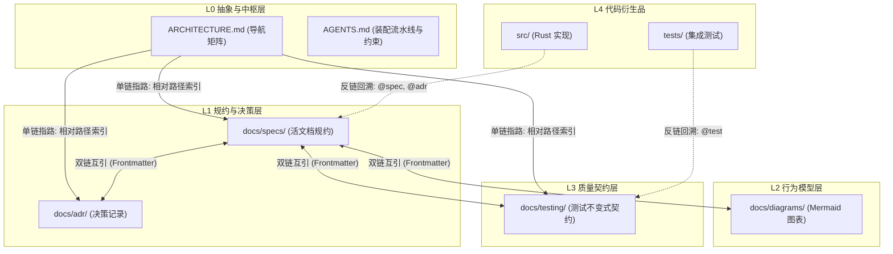

# Document / Spec As Code (SAC) 方法论与工程落地规范

本文件沉淀 SAC 系统的核心规范、文档分级体系、上下文索引与生命周期治理机制.

---

## 一、 核心设计哲学

1. **产品的助产士**:
   - 开发者与 AI 结对, 从最简读写 MVP 开始, 通过逐步深入的方案抉择与 TDD 验证, 不断厘清系统边界与真实需求.
2. **代码作为可丢弃的衍生品**:
   - 代码是当前模型与技术栈下的临时产物; 规约 (Spec)、架构决策 (ADR) 与测试契约 (Test Spec) 是系统唯一真理源 (Ground Truth).
3. **区分时间轴与空间轴**:
   - **时间轴 (助产过程)**: Phase 演进里程碑与 CHANGELOG 记录系统孵化历史与对外发版履历, 不作为代码生成的输入约束.
   - **空间轴 (系统规约)**: `docs/specs/` 与 `docs/testing/` 是“活文档 (Living Documents)”, 永远描述系统当前生效的完整真实契约.
4. **拓扑装配而非历史重演**:
   - 当使用新模型从规约重建 (Rebuild from Spec) 时, 直接依据最新 Spec, 沿系统无环拓扑依赖图 (DAG) 自底向上装配终态组件, 绝不重演已被推翻的历史过渡代码.

---

## 二、 文档四层分级规范

| 层级 | 定位与目标 | 典型文件 / 目录 | 加载与寻址方式 |
| :--- | :--- | :--- | :--- |
| **L0 抽象与中枢层** | 项目全貌、领域认知、导航中枢与开发硬约束 | `README.md`<br>`CONTEXT.md`<br>`ARCHITECTURE.md`<br>`CHANGELOG.md`<br>`AGENTS.md` | 会话开启或任务启动时全局加载 (控制在 8KB 以内) |
| **L1 规约与架构决策层** | 领域能力活规约与不可变架构决策记录 | `docs/specs/*.md`<br>`docs/adr/*.md` | 依据 L0 全景导航矩阵按需 $O(1)$ 精准单步加载 |
| **L2 行为模型层** | 可视化时序图、数据流图与状态机 | `docs/diagrams/*.md` | 按需定点加载 (基于 Mermaid 标准语法) |
| **L3 质量契约层** | 测试分层金字塔、核心系统不变式矩阵与混沌故障注入契约 | `docs/testing/*.md` | TDD 驱动代码实现时的硬性质量门禁 (Gate) |
| **L4 代码衍生品** | 可丢弃、可根据 Spec 重建的实现与自动化测试代码 | `src/`<br>`tests/` | 头部附带反链回溯注解 |

---

## 三、 上下文治理: 定位与三向链接机制

为了根除 AI 上下文过载与盲目搜索, 建立以下三向链接图谱:



1. **单链 (自顶向下指路)**:
   - 在 L0 `ARCHITECTURE.md` 的导航矩阵中, 使用标准 Markdown 相对路径直接指向下层文档.
2. **双链 (横向互相锚定)**:
   - 每个 L1/L2/L3 文档顶部采用标准 YAML Frontmatter 声明关联关系 (`id`, `layer`, `domain`, `related`).
3. **反链 (自底向上回溯)**:
   - 每个核心源文件头部必须包含文档注释反链, 确保维护人员或 AI 能够逆向溯源至唯一真理源:
     ```rust
     //! @spec    docs/specs/...
     //! @adr     docs/adr/...
     //! @test    docs/testing/...
     ```
4. **单向稳定依赖原则 (L0-L3 不得硬编码 L4 代码细节)**:
   - 依赖严格单向化: L0-L3 规约是稳定的领域契约, 严禁包含对 L4 源码路径 (`src/`)、私有文件名或易变测试函数名的反向硬编码引用.
   - 双链关系仅存在于 L0-L3 长期维护的稳定规约之间; 由 L4 可重写的代码单向回溯 L0-L3 规约.

---

## 四、 测试分层金字塔与质量门禁 (Testing Pyramid)

测试契约是代码生成的唯一约束. 测试体系划分为三个清晰层次:

```text
       / \
      / L3 \       黑盒端到端与混沌故障注入集成测试 (Blackbox & Chaos Integration)
     /------\      (对外 API 契约、并发无锁、突发断电残损物理自愈截断)
    /   L2   \     组件级双向往返测试 (Component Roundtrip & Boundary)
   /----------\    (子系统写入与回放 100% 对齐、单组件边界容错)
  /     L1     \   数据结构与二进制编解码单元测试 (Unit & Codec Defense)
 /--------------\  (固定头部编解码、CRC32 校验、边界溢出防御)
```

1. **L1 单元测试**: 纯内存运行, 无文件 I/O 依赖, 极速验证纯数据结构与编解码边界.
2. **L2 组件往返测试**: 单一子系统闭环验证, 确保写入与读取两端的协议绝对自洽.
3. **L3 黑盒端到端与混沌集成测试**: 面向对外公共 API 与物理断电/介质损坏场景的终极断言.

### L3 测试规约标准模型 (总览矩阵 + 四段式规约)
所有 L3 测试契约文档统一遵循「场景总览表 + 四段式规约」模板:
- **用例编号规范**: `TC-[CATEGORY]-[INDEX]` (如 `TC-INV-01`, `TC-CHAOS-01`).
  - `TC`: Test Case (国际通用测试用例标识).
  - `INV`: Invariant (核心功能与数学定理不变式).
  - `CHAOS`: Chaos / Fault (物理掉电与介质损坏混沌测试).
- **四段式条目结构**:
  - `核心不变式 (Invariant)`: 业务或系统永恒满足的一句话定理.
  - `前置与注入条件 (Preconditions & Injection)`: 环境设置或模拟注入方式.
  - `执行步骤与逻辑 (Procedure)`: 明确的 1/2/3 逻辑步骤.
  - `验收判定门禁 (Acceptance Criteria)`: 判定 PASS 的物理硬性判定依据.

---

## 五、 规约演化与决策替代 (Supersede)

1. **按领域能力持久命名规约**:
   - 严禁按过程里程碑命名 Spec (如使用 `wal-storage.md` 而非 `phase2-wal.md`). 系统演化时, 在对应领域 Spec 上就地增量修改, 保持“活文档”属性.
2. **ADR 变更链条**:
   - 架构决策一旦被采纳则永久冻结; 当后续阶段推翻或升级前序决策时, 在旧 ADR 标记 `status: superseded`, `superseded_by: adr-xxxx`, 并新建 `supersedes: adr-yyyy` 的新 ADR.

---

## 六、 各层文件的职责边界界定 (杜绝重叠)

各文件分工明确、界限分明, 避免多处维护相同内容:

| 文件路径 | 层级 | 受众角色 | 核心职责与内容界限 |
| :--- | :--- | :--- | :--- |
| **`README.md`** | L0 | **给人看的** | 项目愿景、为什么自研与解决的痛点、快速上手、业务演进路线图 (Milestones). |
| **`AGENTS.md`** | L0 | **给 AI 看的** | 开发注意事项、SAC 编码纪律、Rebuild 执行协议、Frontmatter 与反链格式、路径约束. |
| **`ARCHITECTURE.md`** | L0 | **技术与架构** | 当前系统架构图、Rebuild 拓扑装配流水线 DAG、L1-L3 资产导航矩阵. |
| **`CONTEXT.md`** | L0 | **全员术语基座** | 纯领域术语词典 (伴生增量沉淀 `DB`, `UserKey`, `WAL`, `CRC32` 等), 统一认知. |
| **`CHANGELOG.md`** | L0 | **对外发版与审计** | 面向使用者的版本发布履历与变更说明 (按语义化版本记录). |
| **`src/README.md`** | L4 | **物理源码映射** | 当前已有源码目录的自解释树形映射 (伴生维护, 不作为重构刚性约束). |

