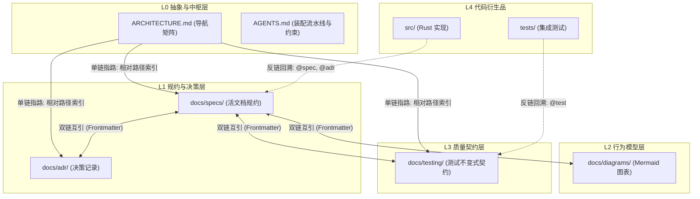
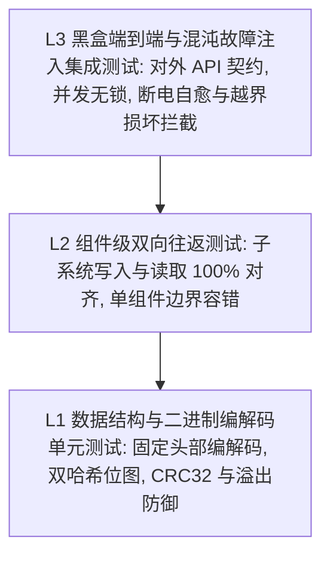
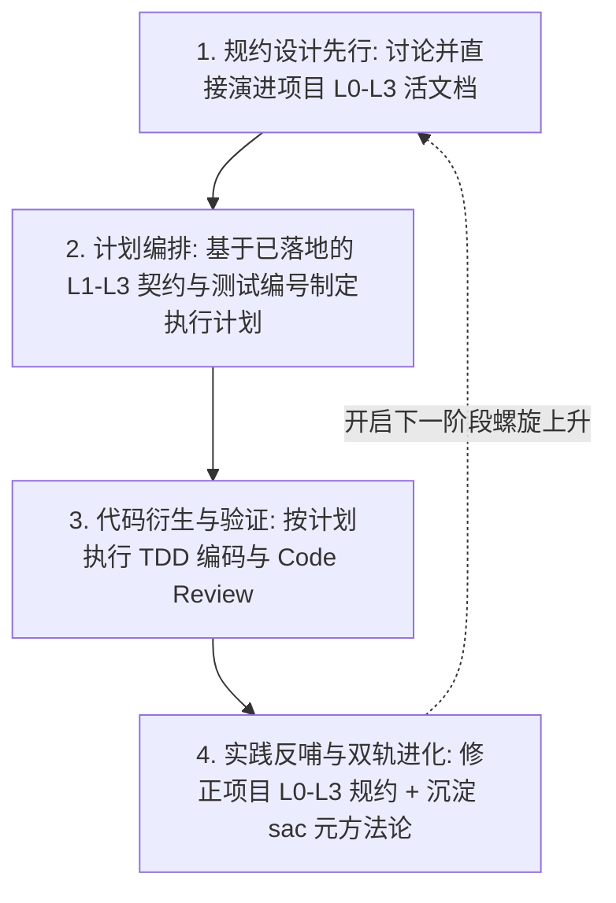

# Document / Spec As Code (SAC) 方法论与工程落地规范

本文件沉淀 SAC 系统的核心规范、文档分级体系、上下文索引与生命周期治理机制.

---

## 一、 核心设计哲学

1. **产品的助产士**:
   - 开发者与 AI 结对, 从最简读写 MVP 开始, 通过逐步深入的方案抉择与 TDD 验证, 不断厘清系统边界与真实需求.
2. **代码作为可丢弃的衍生品**:
   - 代码是当前模型与技术栈下的临时产物; 规约 (Spec)、架构决策 (ADR) 与测试契约 (Test Spec) 是系统唯一真理源 (Ground Truth).
3. **区分时间轴与空间轴**:
   - **时间轴 (助产过程)**: Phase 演进里程碑与 CHANGELOG 记录系统孵化历史与对外发版履历, 不作为代码生成的输入约束.
   - **空间轴 (系统规约)**: `docs/specs/` 与 `docs/testing/` 是“活文档 (Living Documents)”, 永远描述系统当前生效的完整真实契约.
4. **拓扑装配而非历史重演**:
   - 当使用新模型从规约重建 (Rebuild from Spec) 时, 直接依据最新 Spec, 沿系统无环拓扑依赖图 (DAG) 自底向上装配终态组件, 绝不重演已被推翻的历史过渡代码.

---

## 二、 文档四层分级规范

| 层级 | 定位与目标 | 典型文件 / 目录 | 加载与寻址方式 |
| :--- | :--- | :--- | :--- |
| **L0 抽象与中枢层** | 项目全貌、领域认知、导航中枢与开发硬约束 | `README.md`<br>`CONTEXT.md`<br>`ARCHITECTURE.md`<br>`CHANGELOG.md`<br>`AGENTS.md` | 会话开启或任务启动时全局加载 (控制在 8KB 以内) |
| **L1 规约与架构决策层** | 领域能力活规约与不可变架构决策记录 | `docs/specs/*.md`<br>`docs/adr/*.md` | 依据 L0 全景导航矩阵按需 $O(1)$ 精准单步加载 |
| **L2 行为模型层** | 可视化时序图、数据流图与状态机 | `docs/diagrams/*.md` | 按需定点加载 (基于 Mermaid 标准语法) |
| **L3 质量契约层** | 测试分层金字塔、核心系统不变式矩阵与混沌故障注入契约 | `docs/testing/*.md` | TDD 驱动代码实现时的硬性质量门禁 (Gate) |
| **L4 代码衍生品** | 可丢弃、可根据 Spec 重建的实现与自动化测试代码 | `src/`<br>`tests/` | 头部附带反链回溯注解 |

---

## 三、 上下文治理: 定位与三向链接机制

为了根除 AI 上下文过载与盲目搜索, 建立以下三向链接图谱:



1. **单链 (自顶向下指路)**:
   - 在 L0 `ARCHITECTURE.md` 的导航矩阵中, 使用标准 Markdown 相对路径直接指向下层文档.
2. **双链 (横向互相锚定)**:
   - 每个 L1/L2/L3 文档顶部采用标准 YAML Frontmatter 声明关联关系 (`id`, `layer`, `domain`, `related`).
3. **反链 (自底向上回溯)**:
   - 每个核心源文件头部必须包含文档注释反链, 确保维护人员或 AI 能够逆向溯源至唯一真理源:
     ```rust
     //! @spec    docs/specs/...
     //! @adr     docs/adr/...
     //! @test    docs/testing/...
     ```
4. **单向稳定依赖原则 (L0-L3 不得硬编码 L4 代码细节)**:
   - 依赖严格单向化: L0-L3 规约是稳定的领域契约, 严禁包含对 L4 源码路径 (`src/`)、私有文件名或易变测试函数名的反向硬编码引用.
   - 双链关系仅存在于 L0-L3 长期维护的稳定规约之间; 由 L4 可重写的代码单向回溯 L0-L3 规约.

---

## 四、 测试分层金字塔与质量门禁 (Testing Pyramid)

测试契约是代码生成的唯一约束. 测试体系自顶向下划分为三个清晰层次:



1. **L1 单元测试**: 纯内存运行, 无文件 I/O 依赖, 极速验证纯数据结构与编解码边界.
2. **L2 组件往返测试**: 单一子系统闭环验证, 确保写入与读取两端的协议绝对自洽.
3. **L3 黑盒端到端与混沌集成测试**: 面向对外公共 API 与物理断电/介质损坏场景的终极断言.

### L3 测试规约标准模型: Hub & Spoke 分层解耦架构

为防止随着系统演进出现单文件行数爆炸, L3 测试规约采用 **「中枢总览表 (Hub) + 领域明细规约 (Spoke)」** 的两级解耦架构:

```shell
docs/testing/
├── specs/                        # [Spoke] 领域与管道四段式明细规约
│   ├── chaos-sstable-faults.md   # SSTable 故障注入明细
│   ├── chaos-wal-faults.md       # WAL 故障注入明细
│   ├── invariants-flush.md       # 落盘管道不变式明细
│   ├── invariants-memtable.md    # 内存表不变式明细
│   ├── invariants-sstable.md     # SSTable 与过滤器不变式明细
│   └── invariants-wal.md         # 预写日志不变式明细
├── chaos-matrix.md               # [Hub] 混沌故障注入总览矩阵 (精简 4 列索引)
└── invariants-matrix.md          # [Hub] 核心不变式总览矩阵 (精简 4 列索引)
```

1. **中枢总览表 (Hub Matrix)**:
   - 仅保留精简 4 列 (`| 用例编号 | 场景名称 | 关联组件 / 模拟故障类别 | 验收目标摘要 |`), 不设冗余层级列.
   - 跳转链接直接挂载在「用例编号」上 (如 `[**TC-INV-01**](./specs/invariants-memtable.md#tc-inv-01)`), 实现单次点击直达明细.
2. **领域明细规约 (Spoke Specs)**:
   - **纯粹两段式命名**: 统一采用 `invariants-<主体>.md` 与 `chaos-<主体>.md`, 严格保持与 `TC-INV-*` 和 `TC-CHAOS-*` 顶层分类前缀的正交对称, 不引入破坏分类前缀的裸名词.
   - **平铺优先原则 (Rule of 10)**: 在 `specs/` 目录下文件数量未超过 10 ~ 15 个之前, 保持扁平化平铺, 不提前拆分二级子目录.
3. **用例编号与四段式结构**:
   - **编号规范**: `TC-[CATEGORY]-[INDEX]` (`TC-INV-xx` 代表核心功能与状态流转不变式, `TC-CHAOS-xx` 代表物理掉电与介质损坏混沌测试).
   - **100% 身份覆盖纪律**: 所有集成测试函数必须标注 `@test TC-xxx` 与 `@see` 规约锚点反链, 严禁代码中存在无契约身份的测试.
   - **四段式条目**: `核心不变式 (Invariant)`, `前置与注入条件 (Preconditions & Injection)`, `执行步骤与逻辑 (Procedure)`, `验收判定门禁 (Acceptance Criteria)`.

---

## 五、 螺旋演进工作流与规约治理

### 1. 四步螺旋演进闭环: 规约先行与实践反哺

每个迭代阶段 (Phase) 严格遵循 **「规约设计先行 -> 依规约排计划 -> 代码衍生验证 -> 实践反哺进化」** 的四步闭环, 杜绝「先写代码, 事后补文档」的因果倒置:



1. **第一阶段: 规约设计先行 (Spec-First Design)**:
   - 在架构讨论 (`brainstorming`) 阶段, 直接新建或演进项目内的 L0-L3 活文档 (`CONTEXT.md`, `docs/adr/`, `docs/specs/`, `docs/diagrams/`, `docs/testing/`), 正式分配 `TC-INV-xx` / `TC-CHAOS-xx` 编号.
   - **单一规约源纪律**: 直接以项目的 L0-L3 活文档替代传统的临时单文件设计稿 (`superpowers/specs/`), 彻底消除双份 Spec 的重复维护.
2. **第二阶段: 依规约编排计划 (Plan from Contracts)**:
   - 基于已落地的 L1 规约与 L3 测试矩阵生成时间轴施工计划 (`superpowers/plans/`), 每个实施步骤直接锚定对应的 Spec 章节与测试编号.
3. **第三阶段: 代码衍生与验证 (L4 Derivation & TDD)**:
   - 按计划执行 TDD 编码与审查; 生成的 L4 代码 (`src/`, `tests/`) 在诞生时即挂载真实存在的规约反链, 并以此实战检验 L1-L3 文档是否清晰完备.
4. **第四阶段: 实践反哺与双轨进化 (Practical Feedback & Meta-Evolution)**:
   - **提交前强制反哺门禁**: 严禁在 Step 3 代码与审查通过后直接跳去执行 `git commit`. 先验规约必然存在物理与运行时认知盲区, 必须在提交前对照实战代码执行以下 **四项反哺巡检清单 (Pre-Commit Feedback Checklist)**:
     1. **物理与算术边界校准**: 将编码与 Code Review 中暴露出的底层防御边界 (如块句柄上限需扣除尾部 `Footer` 尺寸, 解码容量上限门禁, 32 位 wrapping 模算术对称性等) 同步回 `docs/specs/` 与 `docs/adr/`;
     2. **测试规约去内部耦合**: 若测试落地时发现先验规约误写了内部状态细节 (如猜测硬编码了动态轮转后的文件序号), 立即修正 `docs/testing/specs/`, 保持黑盒语义纯粹;
     3. **存量活文档与图表跟进**: 检查前序 Phase 的关联活文档 (`docs/specs/`) 与时序图 (`docs/diagrams/`) 是否因新增组件而滞后, 及时就地演进 (注意: 历史已采纳的 `docs/adr/` 保持冻结, 严禁逆向篡改);
     4. **源码反链与元方法论沉淀**: 核对所有受影响源码文件头部的 `@spec` / `@adr` / `@test` 反链完整性, 并将通用的文档组织与工程治理洞察提炼沉淀回 `sac` 元方法论仓库.

### 2. 活规约演进 vs ADR 不可变时间因果律

1. **活规约 (`docs/specs/`) 就地演进与全集聚合**:
   - 严禁按过程里程碑命名 Spec (如使用 `sstable-format.md` 而非 `phase3-sstable.md`).
   - 系统演化时, 在对应领域 Spec 上就地增量修改, 并在其 Frontmatter `related.adr` 中聚合挂载所有生效的相关 ADR (如同时关联 `0004` 与 `0005`), 保持空间轴“活文档”属性.
2. **架构决策 (`docs/adr/`) 不可变性与单向时间因果律**:
   - ADR 是时间轴上的**不可变历史决策快照 (Append-Only)**, 一旦采纳 (`status: accepted`) 则正文永久冻结, 严禁让旧编号 ADR 逆向依赖或引用新编号 ADR (如严禁在 `0004` 中添加对 `0005` 的依赖或篡改当时记录的代价).
   - **模式 A — 增量扩展 / 细化 (Extends / Refines)**: 当新 ADR (如 `0005`) 是在旧 ADR (`0004`) 基础上的增量扩展而非推翻时, 旧 ADR (`0004`) 保持原状不动; 由新 ADR (`0005`) 在 `related.adr` 中**单向回溯**指向旧 ADR (`0004`), 符合时间因果有向无环图 (DAG).
   - **模式 B — 推翻与替代 (Supersedes)**: 仅当旧 ADR 的核心决策被后续阶段彻底废弃推翻时, 才允许修改旧 ADR 的 Frontmatter 状态为 `status: superseded` 并注明 `superseded_by: adr-xxxx` (正文仍保持历史原貌), 同时在新 ADR 声明 `supersedes: adr-yyyy`.

---

## 六、 各层文件的职责边界界定 (杜绝重叠)

各文件分工明确, 界限分明, 避免多处维护相同内容:

| 文件路径 | 层级 | 受众角色 | 核心职责与内容界限 |
| :--- | :--- | :--- | :--- |
| **`README.md`** | L0 | **给人看的** | 项目愿景, 为什么自研与解决的痛点, 快速上手, 业务演进路线图 (Milestones). |
| **`AGENTS.md`** | L0 | **给 AI 看的** | 开发注意事项, SAC 四步演进工作流, Rebuild 执行协议, Frontmatter 与反链格式, 路径约束. |
| **`ARCHITECTURE.md`** | L0 | **技术与架构** | 当前系统架构图, Rebuild 拓扑装配流水线 DAG, L1-L3 资产导航矩阵. |
| **`CONTEXT.md`** | L0 | **全员术语基座** | 纯领域术语词典 (伴生增量沉淀 `DB`, `UserKey`, `WAL`, `SSTable` 等), 统一认知. |
| **`CHANGELOG.md`** | L0 | **对外发版与审计** | 面向使用者的版本功能与行为变更履历; **严禁出现 `L0/L1/SAC` 等元概念或 `*.rs` 私有源码文件名**. |
| **`src/README.md`** | L4 | **物理源码映射** | 当前已有源码目录的自解释树形映射 (伴生维护, 不作为重构刚性约束). |

